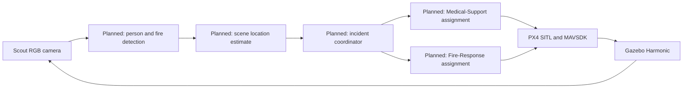

# Drone-Swarm: Multi-Drone Disaster Response Simulation

A simulation prototype for exploring how a small drone team could search an
earthquake and landslide scene, report incidents, and coordinate specialist
responses. It uses **PX4 SITL**, **Gazebo Harmonic**, and **MAVSDK-Python** on
Ubuntu. It does not use ROS or ROS 2.

The project has three simulated roles:

- **Scout:** flies with a downward-facing RGB camera and searches the scene.
- **Medical-Support:** intended to respond to reported human victims.
- **Fire-Response:** intended to respond to reported fires.

The target workflow is: Scout camera frames → person/fire detections → estimated
scene locations → incident assignment → specialist drone mission → operator
monitoring. At the current stage, the camera stream and scene are available, but
automatic detection, localization, dispatch, and the operational dashboard are
not implemented. The role descriptions are project goals, not claims of
completed autonomous capability.

## Project status

| Area | Status |
| --- | --- |
| Apron earthquake/landslide Gazebo world | Selected environment; used by the default launcher |
| Three PX4 SITL vehicles | Have spawned and connected in prior runs |
| Scout vertical takeoff, hover, and landing | 3 m check completed; user confirmed normal landing |
| Scout camera | Gazebo image topic and H.264/RTP stream observed; airborne RGB frame captured |
| Victim scene annotations | Five model poses are recorded as ground truth |
| Person and fire/smoke detection | Not implemented |
| Camera-based world localization | Not implemented or measured |
| Incident coordinator and specialist dispatch | Not implemented |
| Live operator dashboard | Not implemented; `src/relay/viewer.py` is a replay viewer |
| Three-drone waypoint flight | Blocked: MAVSDK gRPC stream disconnected at Offboard control; diagnose before retrying |

The full day-by-day progress and acceptance criteria are in the
[14-day implementation plan](docs/DRONE_SWARM_14_DAY_PLAN.md). It distinguishes
verified work from pending work and is the continuation guide for teammates.

## System design



Gazebo provides the simulated environment and vehicles. PX4 handles flight
control; MAVSDK provides mission-level commands. The existing discrete MAPPO
research code is preserved separately. It is a possible future high-level
coordination component and does not replace PX4 flight control. See the
[legacy RELAY/MAPPO guide](docs/RELAY_LEGACY_README.md) for its original setup.

## Requirements

- Ubuntu with PX4 Autopilot SITL and Gazebo Harmonic installed.
- Python 3 and the `mavsdk-grpc` package in the project’s `.venv-mavsdk`
  environment.
- Host `/usr/bin/python3` with PyGObject/GStreamer bindings for the provided
  one-frame camera capture helper.
- The Scout camera stream uses UDP port 5600; close other receivers on that port
  before capturing a frame.

The PX4 checkout is external to this repository. The launcher defaults to
`/tmp/PX4-Autopilot`; set `PX4_AUTOPILOT_DIR` if your PX4 checkout is elsewhere.

Create the MAVSDK virtual environment once if it is not already present:

```bash
python3 -m venv .venv-mavsdk
source .venv-mavsdk/bin/activate
python -m pip install --upgrade pip
python -m pip install 'mavsdk-grpc>=3.17,<4'
```

The camera capture helper uses the host Python GStreamer bindings, so it runs
with `/usr/bin/python3`, not with `.venv-mavsdk`.

## Start the simulation

From the repository root, launch the three-vehicle SITL session:

```bash
./integration/mavsdk_controller/launch_three_px4.sh
```

The launcher defaults to `worlds/earthquake_landslide_apron_world.sdf` and
writes logs under `/tmp/drone-swarm-px4-multi-<uid>/`. Do not start a second
launcher while another PX4/Gazebo session is running. The launcher’s `stop`
subcommand stops PX4 and Gazebo processes system-wide; check that they belong to
this project before using it.

### Verified Scout-only hover check

Use a second terminal after all vehicles have connected. This test moves Scout
vertically only and does not use Offboard waypoints:

```bash
source .venv-mavsdk/bin/activate
python integration/mavsdk_controller/scout_hover_check.py \
  --altitude 3 --hover-seconds 10 \
  --telemetry-log /tmp/scout-hover-check.jsonl
```

A higher vertical hover can be requested with `--altitude 8 --hover-seconds 30`.
Capture during the hold and wait for the script to confirm landing before
starting another flight.

### Capture a Scout camera frame

While Scout is airborne and its camera stream is active, close any other viewer
receiving UDP 5600, then run:

```bash
/usr/bin/python3 integration/mavsdk_controller/capture_scout_frame.py \
  --output /tmp/scout_camera_frame.ppm
xdg-open /tmp/scout_camera_frame.ppm
```

A successful capture prints the saved image dimensions. This helper captures a
single frame; it does not detect or identify victims.

## Current limitations and safe continuation

- Do not retry `three_drone_takeoff_demo.py` yet. Its MAVSDK gRPC stream closed
  during Offboard waypoint control, and PX4 reported a Hold failsafe after the
  link loss. The cause has not been established. Diagnose it and validate a
  short Scout-only waypoint before a multi-drone waypoint mission.
- Camera frames are captured, but person/fire detection and camera-to-world
  localization still need implementation and evaluation against the victim
  ground-truth poses.
- The fire/smoke assets have produced Gazebo missing particle texture warnings;
  check and repair their resources before relying on those visuals.
- Do not change PX4 parameters, drone models, propellers, or low-level flight
  control to work around an unexplained issue.
- Do not claim autonomous detection, medical diagnosis, real-world readiness,
  or response capability without successful evidence.

## Repository map

| Path | Purpose |
| --- | --- |
| `worlds/earthquake_landslide_apron_world.sdf` | Selected disaster-response world |
| `worlds/earthquake_landslide_apron_ground_truth.json` | Five victim model IDs and poses for evaluation |
| `worlds/disaster_assets/` | Local world meshes, victim models, and fire/smoke assets |
| `integration/mavsdk_controller/launch_three_px4.sh` | Starts the three PX4 SITL vehicles and Gazebo |
| `integration/mavsdk_controller/scout_hover_check.py` | Scout vertical takeoff, hover, and land check |
| `integration/mavsdk_controller/capture_scout_frame.py` | One-frame camera stream capture helper |
| `integration/mavsdk_controller/drones.json` | Vehicle roles, ports, and demo waypoint offsets |
| `src/relay/viewer.py` | Existing MAPPO replay viewer, not the live drone dashboard |
| `docs/DRONE_SWARM_14_DAY_PLAN.md` | Day-by-day status, acceptance criteria, and remaining work |
| `docs/RELAY_LEGACY_README.md` | Preserved setup guide for the discrete MAPPO/RELAY research code |

**Configuration note:** the launcher uses spawn poses defined in its shell
script. The `spawn_pose` fields in `drones.json` do not set Gazebo spawn poses.

## Project boundaries

This is a simulation prototype. It does not include real flights, hardware-in-the-loop
testing, ROS, full SLAM, raw-image model training, or direct motor control from
MAPPO. Keep existing MAPPO checkpoints and experiments intact.
